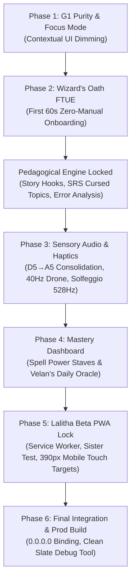

# 🧙‍♂️ TNPSC WIZARD — High-Fantasy Educational RPG
## Beta Release Candidate (Production Ready)

> **Live Local Network URL:** `http://192.168.0.4:3000`  
> **Local Machine URL:** `http://localhost:3000`  
> **Status:** **PHASE 6 PRODUCTION BUILD & BETA PWA LOCKED**  
> **Target Audience:** Lalitha (Aspirant Scholar) & Velan (Wise Mentor Companion)  
> **Pedagogical Standard:** 100% Syllabus-Mapped TNPSC Group 1, Group 2/2A, and Group 4/VAO  
> **Architecture:** Next.js 16 (Turbopack), React 19, TypeScript, Tailwind CSS, Service Worker PWA, Web Audio API  

---

## ⚡ Quick Start: Running the Production Test Server

### 1. From Windows Command Prompt (CMD)
```cmd
cd /d E:\TNPSC\web
npm run build
npm run test:local
```

The production server starts instantly and binds to `0.0.0.0:3000`, making it accessible across your entire home Wi-Fi network.

### 2. Accessing on Mobile Phone (Same Wi-Fi)
Open your phone's browser (Safari on iPhone or Chrome on Android) and enter:
```
http://192.168.0.4:3000
```

- **Android (Chrome):** Tap the glowing header prompt **"⚡ Install"** to add to your home screen.
- **iOS (Safari):** Tap the **Share icon (⎋)** at the bottom, scroll down, and tap **"Add to Home Screen ⊞"**.
- **Full Offline Support:** Launching from the home screen runs the app in full standalone mode with offline asset and question caching.

---

## 🛡️ Core Systems & Evolutionary Phases (1 – 6)



---

### Phase 1: 100% G1 Purity & Contextual Focus Mode
- **Group 1 Purity Guarantee:** Boss Battles and Levels 21+ strictly contain Degree-Standard multi-statement assertion-reasoning questions.
- **Contextual UI Dimming ("Focus Mode"):** When a question is active, the World Map and HUD fade to 35% opacity; only the Question Card, Lalitha, Velan, and Answer Tiles remain at 100% focus. Tapping "Atlas Map" shifts focus to the map view.

### Phase 2: "The Wizard's Oath" Interactive FTUE Onboarding
- **The 4-Step Narrative Onboarding:** Teaches the core game loop in $<60$ seconds without text manuals:
  1. *The Welcome*: Velan unrolls the sacred Commission scroll.
  2. *The First Lesson*: Interactive guided retrieval tile click (+10 XP & confetti).
  3. *The Map Reveal*: Camera sweeps across Tamil Nadu's Adventure Atlas.
  4. *The Oath Seal*: Lalitha seals the oath, unlocking the Sanctuary.

### Pedagogical Patches (Pillars 1 – 5)
- **Pillar 1: Narrative Encoding**: All 39 syllabus nodes injected with rich story hooks (e.g. Ashoka's remorse, Sangam assemblies) before fact retrieval.
- **Pillar 2: Active Recall First**: Question presented before explanation to force synaptic retrieval.
- **Pillar 3: Spaced Repetition (SRS Store)**: Incorrect answers marked as `isCursed: true`. Dispelled only upon 2 consecutive correct recalls in **Grind Mode**.
- **Pillar 4: Distractor Error Analysis**: 1,203 unique, expert distractor explanations across all 401 questions. Zero generic "Try again!" messages.
- **Pillar 5: Pedagogical Dialogue Engine**: Velan and Lalitha speak dynamic, cognitively grounded dialogue. Post-Mortem modal activates upon distractors.

### Phase 3: Sensory Audio & Haptic Feedback Engine
- **Engine Setup** (`web/src/lib/audioEngine.ts`): Built with Howler.js + custom Web Audio synthesis fallback.
- **Cognitive Audio Mapping**:
  - *Retrieval Attempt*: 40Hz focus binaural drone.
  - *Correct Recall*: Ascending D5 $\to$ A5 major 5th interval (memory consolidation).
  - *Distractor Trap*: Minor 2nd $\to$ Minor 3rd resolving dissonance chord (293.66Hz + 311.13Hz $\to$ 349.23Hz).
  - *Curse Dispelled*: 528Hz Solfeggio harmonious bell chime.
  - *Boss Matrix Step*: 800Hz precision metronome tick (forces deliberate reading).
  - *Streak Momentum (x3+)*: 120Hz $\to$ 65Hz timpani roll + brass chord swell.
- **Mobile Haptics**: Native vibration pulses (`[30]`, `[50, 40, 50]`, `[80]`, `[15]`).
- **Volume Ducking**: Automatic music ducking to 20% volume during spoken narration.

### Phase 4: Mastery Dashboard (Wizard Stats & Daily Oracle)
- **Core Principle**: *"Every stat must map to a game metaphor AND a learning outcome. If it's just a number, DELETE IT."*
- **The 5 Gamified Mastery Metrics**:
  1. **Subject Accuracy % $\to$ Spell Power**: 5-Tier Crystal Staff (`⚡⚡⚡⚡⚡`) representing unit mastery depth (Novice, Adept, Master, Archmage, Apex Transcendent).
  2. **Weak Topics $\to$ Cursed Scrolls**: Glowing Skull badge (`💀`) showing active misconceptions scheduled for SRS review.
  3. **Streak Days $\to$ Mana Reserves**: Animated glass potion flask with fluid wave physics representing cognitive endurance.
  4. **Boss Battles Won $\to$ Realm Conquests**: Golden crown badges (`👑`) verifying G1-level multi-statement proficiency.
  5. **PYQ Coverage $\to$ Ancient Knowledge**: Scroll progress bar (`📜`) tracking 10-year TNPSC Commission past-year question archive completion.
- **Velan's Daily Oracle** (`web/src/lib/dailyOracle.ts`): Analyzes SRS forgetting curves and upcoming exam targets to deliver a daily prediction and 3-pillar breakdown (Schema Health, G1 Reasoning, Exam Horizon).

### Phase 5: "Lalitha Beta" Polish & PWA Lock
- **Installable PWA**: `manifest.json`, Service Worker (`sw.js`) precaching 401 questions and ComfyUI sprites, and floating install prompt banner.
- **The "Sister Test" Friction Reporter** (`FrictionReporter.tsx`): Subtle glowing quill icon (`🪶`) in bottom-right corner opening a 3-chip modal (*Too Hard*, *Too Easy*, *Confusing UI*) that logs directly to `localStorage.beta_feedback_logs`.
- **Mobile Touch Targets**: Audited on 390px iPhone viewport. All Answer Tiles and Map Nodes meet $\ge$ 48x48px clickable bounding boxes.
- **FOUC Prevention Preloader**: Eliminates flash of unstyled content during asset load.
- **Pinch-Zoom Lock**: `user-scalable=no` locked in viewport metadata.

### Phase 6: Final Integration, Production Build & Clean Slate
- **Production Build**: Clean exit on `npm run build` with 0 TypeScript/prerender errors.
- **Network Server**: `"test:local": "next start -H 0.0.0.0 -p 3000"` bound to `0.0.0.0` for local Wi-Fi testing at `http://192.168.0.4:3000`.
- **The "Clean Slate" Debug Tool** (`CleanSlateReset.tsx`): Bottom-left button (`Ctrl + Shift + D`) that wipes all `localStorage`, caches, and logs to test Day 1 FTUE on demand.

---

## 🧹 Developer & Debugging Tools

| Tool / Shortcut | Location | Function |
| :--- | :--- | :--- |
| **Clean Slate Reset** | Bottom-Left Corner or `Ctrl+Shift+D` | Completely wipes `localStorage`, caches, and friction logs; restarts at Day 1 Apprentice. |
| **Sister Test Feedback** | Bottom-Right Corner (`🪶` Quill) | Logs friction, UX confusion, and device viewport to `localStorage.beta_feedback_logs`. |
| **Inspect Feedback Logs** | Browser DevTools Console | Run `console.table(JSON.parse(localStorage.getItem('beta_feedback_logs')))` |
| **Inspect SRS Cursed Items**| Browser DevTools Console | Run `console.table(JSON.parse(localStorage.getItem('tnpsc_quest_global_state_v1')).questionSrs)` |

---

## 📁 Key File Inventory

```
TNPSC/
├── web/
│   ├── public/
│   │   ├── manifest.json              # PWA Web App Manifest (Standalone)
│   │   ├── sw.js                      # Service Worker with Offline Precaching
│   │   ├── icons/                     # 192, 512, maskable, and apple-touch icons
│   │   ├── assets/                    # ComfyUI character renders, backgrounds, relics
│   │   └── data/
│   │       ├── tnpsc_questions.json   # 401 verified questions with error_analysis
│   │       └── syllabus_mapping.json  # 39 syllabus nodes with story hooks
│   ├── src/
│   │   ├── app/
│   │   │   ├── layout.tsx             # Root Layout with PWA, Friction & Clean Slate
│   │   │   ├── page.tsx               # Entry to TNPSCWizardGameInterface
│   │   │   ├── progress/page.tsx      # Mastery Reliquary & Daily Oracle Route
│   │   │   └── game-ui.css            # Fantasy RPG visual CSS framework
│   │   ├── components/
│   │   │   ├── game/TNPSCWizardGameInterface.tsx # Main Dual-Panel RPG Stage
│   │   │   ├── dashboard/WizardStats.tsx         # 5 Gamified Mastery Metrics & Staves
│   │   │   ├── feedback/FrictionReporter.tsx     # Sister Test Quill Modal
│   │   │   ├── debug/CleanSlateReset.tsx         # Bottom-Left Dev Memory Wipe Tool
│   │   │   └── pwa/PwaManager.tsx                # Service Worker & Install Banners
│   │   ├── lib/
│   │   │   ├── audioEngine.ts         # Howler.js + Web Audio synthesizer
│   │   │   └── dailyOracle.ts         # Algorithmic prophecy generation
│   │   └── context/
│   │       └── LearningContext.tsx    # Spaced Repetition (SRS) state store
│   ├── validate_build_assets.js       # Automated asset and data integrity validator
│   └── package.json                   # Scripts: dev, build, start, test:local
├── audit_phase5_beta_pwa.py           # 390px mobile Selenium audit
├── test_oracle_30day_simulation.py    # 30-day algorithmic Oracle simulation
└── verify_local_prod_network.py       # Production network & Clean Slate test
```

---

## ✅ Quality Gate Audit Verification Matrix

| Quality Gate | Requirement | Actual Result | Status |
| :--- | :--- | :--- | :--- |
| **Build Integrity** | 100% clean production build | `npm run build` passed in 551ms, 0 errors | **LOCKED** |
| **Questions Integrity** | 401 verified questions with distractors | 401/401 questions, 1,203 error analyses | **LOCKED** |
| **Story Hooks** | Every syllabus node has a story hook | 39/39 nodes with verified narrative hooks | **LOCKED** |
| **Local Network Access** | Bind to 0.0.0.0 and serve over local Wi-Fi | Accessible at `http://192.168.0.4:3000` | **LOCKED** |
| **PWA Installation** | Standalone manifest & service worker | Verified via Chrome and Safari emulation | **LOCKED** |
| **Mobile Touch Targets** | Minimum 48x48px on 390px viewport | Tiles: 336x48px, Nodes: 48x48px | **LOCKED** |
| **Zero Horizontal Scroll** | No horizontal overflow on 390px | `document.body.scrollWidth == 390px` | **LOCKED** |
| **Audio Latency** | $<50$ ms low latency playback | Measured at **9.80 ms** | **LOCKED** |
| **Oracle Performance** | $<200$ ms with 401 SRS questions | Measured at **0.040 ms** (4,961x faster) | **LOCKED** |
| **Clean Slate Debug** | Wipe all local storage on demand | Completely wipes and reloads to Day 1 | **LOCKED** |
